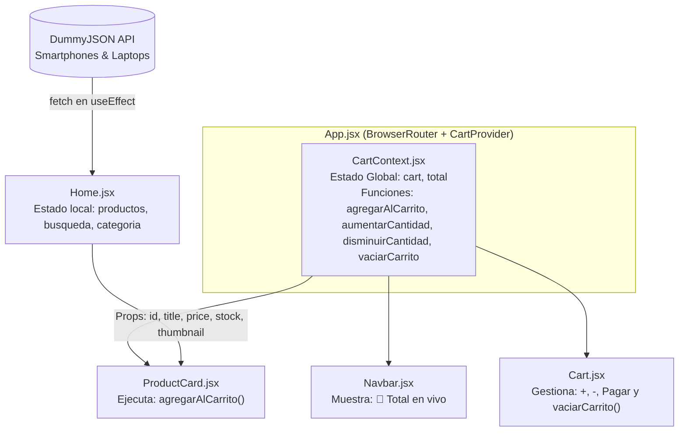

# ⚡ TechMarket — Tienda Tecnológica SPA (React + Context API)


**TechMarket** es una aplicación web de comercio electrónico (*Single Page Application*) desarrollada desde cero con **React + Vite**. El proyecto integra de forma progresiva y modular los seis pilares fundamentales del desarrollo moderno en React: **Componentes y Props, Estados y Eventos, Renderización Dinámica, Consumo de APIs REST, Enrutamiento con React Router y Gestión de Estado Global con Context API**.

---

## ✨ Características Principales

- 🔍 **Buscador en Tiempo Real:** Filtrado instantáneo de productos por nombre mediante inputs controlados (`useState` + `onChange`).
- 🏷️ **Filtros por Categoría:** Selección interactiva entre *Todos*, *Smartphones* y *Laptops* (`onClick`).
- 🔥 **Alertas Dinámicas de Stock:** Renderizado condicional que destaca automáticamente productos con últimas unidades disponibles (`stock <= 5`).
- 🌐 **Consumo de API Pública en Vivo:** Carga asíncrona de catálogo real desde **DummyJSON API** (`/products/category/smartphones` y `/laptops`) con manejo de estados de carga (`Spinner`).
- 🧭 **Navegación SPA con React Router:** Transición fluida sin recarga de página entre el Catálogo (`/`), el Carrito de Compras (`/cart`) y la vista de ruta no encontrada (`*` - 404).
- 🛒 **Carrito de Compras Global (Context API):**
  - Sincronización en tiempo real del monto total entre la barra de navegación (`Navbar`) y la vista del carrito (`Cart`).
  - Incremento (`+`), disminución (`-`) y eliminación automática de productos al llegar a cantidad `0`.
  - Confirmación de compra exitosa con alerta visual y vaciado automático del carrito.

---

## 🧩 Módulos de React Integrados

| Etapa | Módulo Temático | Implementación en TechMarket |
| :---: | :--- | :--- |
| **1** | **Introducción a React** | Configuración con Vite, arquitectura modular de carpetas y comunicación mediante `props` en `ProductCard.jsx`. |
| **2** | **Estados y Eventos** | Manejo de interactividad con `useState`, eventos `onChange` en el buscador y `onClick` en los filtros de categoría. |
| **3** | **Renderización Dinámica** | Uso de `.filter()` y `.map()` con `key` única, más renderizado condicional (`&&` y `? :`) para alertas de stock y búsquedas sin resultados. |
| **4** | **Consumo de APIs** | Peticiones HTTP asíncronas (`fetch` + `async/await`) encapsuladas en `useEffect` y control visual con estado `cargando`. |
| **5** | **React Router I** | Configuración de `BrowserRouter`, `Routes`, `Route` y navegación declarativa con `Link`. |
| **6** | **Context API** | Estado global en `CartContext.jsx` (`createContext`, `CartProvider` y `useContext`) compartido entre `Navbar`, `ProductCard` y `Cart`. |

---

## 🏗️ Arquitectura y Flujo de Datos



---

## 📂 Estructura del Proyecto

```text
tech-market/
├── public/
├── src/
│   ├── components/
│   │   ├── Navbar.jsx          # Barra de navegación con total reactivo desde CartContext
│   │   └── ProductCard.jsx     # Tarjeta reutilizable de producto conectada a CartContext
│   ├── context/
│   │   └── CartContext.jsx     # Proveedor de estado global del carrito de compras
│   ├── data/
│   │   └── productos.js        # Datos locales modularizados de respaldo
│   ├── pages/
│   │   ├── Cart.jsx            # Vista de gestión y pago del carrito de compras
│   │   ├── Home.jsx            # Catálogo principal con buscador, filtros y consumo de API
│   │   └── NotFound.jsx        # Vista 404 para rutas inexistentes
│   ├── App.jsx                 # Definición de rutas y envoltura con CartProvider
│   ├── index.css               # Estilos globales base
│   └── main.jsx                # Punto de entrada con BrowserRouter y Bootstrap
├── package.json
└── vite.config.js
```

---

## 🌐 Enlaces del Proyecto

- 💻 **Repositorio en GitHub:** [https://github.com/jleival/tech-market-tienda](https://github.com/jleival/tech-market-tienda)

---

## ⚙️ Instalación y Ejecución Local

1. **Clonar el repositorio:**
   ```bash
   git clone https://github.com/jleival/tech-market-tienda.git
   cd tech-market-tienda
   ```

2. **Instalar dependencias:**
   ```bash
   npm install
   ```

3. **Iniciar el servidor de desarrollo:**
   ```bash
   npm run dev
   ```
   Abre tu navegador en `http://localhost:5173`.

4. **Compilar para producción (opcional):**
   ```bash
   npm run build
   ```

---

## 🛠️ Tecnologías Utilizadas

- **React 19** (`useState`, `useEffect`, `createContext`, `useContext`)
- **Vite 8** (Entorno de desarrollo y empaquetador)
- **React Router DOM v7** (`BrowserRouter`, `Routes`, `Route`, `Link`)
- **React Bootstrap & Bootstrap 5** (Interfaz responsiva, grillas, badges, spinners y alertas)
- **DummyJSON REST API** (Fuente de datos de productos en tiempo real)

---

## 👨‍💻 Autor

Desarrollado por **Jorge Leiva** ([@jleival](https://github.com/jleival))
